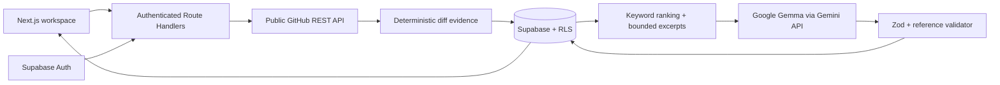
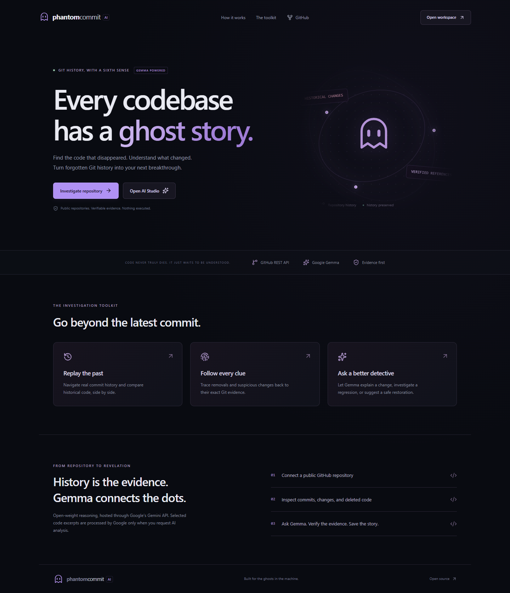

# PhantomCommit AI

**Code Never Truly Dies. It Just Waits to Be Understood.**

An evidence-driven Git history investigation workspace built for Hacktoberfest 2026: Ghost in the Machine. Inspect public GitHub history, examine deleted code, compare snapshots, and ask Google Gemma to explain historical changes with checked source references.

[Source repository](https://github.com/Y-Udayanga/PhantomCommitAI) · Hosted demo: **not deployed yet**.

## What it solves

Current source code cannot tell the whole story of a regression. PhantomCommit preserves the trail between a change, its diff, an AI interpretation, and the original commit. It treats removals and suspicious patterns as evidence to investigate, rather than proof of a bug or developer intent.

## Implemented application

- Responsive real-data investigation workspace. No sample repositories, commits, analytics or AI responses are loaded by the application. Legacy `/demo` links redirect to the real workspace.
- AI Studio with 18 focused tools: explanations, historical questions, risk review, root cause investigation, regression suspects, deleted-code investigation, lineage review, security drift, forgotten-feature leads, restoration plans, test suggestions, impact summaries, intent classification, factual storytelling, next steps and reports.
- Supabase email sign-up, verification callback, sign-in, password recovery, logout, server-verified protected pages and APIs.
- Public repository import, branch selection, 20-commit history pages, detail caching, resumable batches of up to three commits.
- File additions, removals, modifications, renames, hunk line extraction, large-removal and validation/error-handling review leads.
- Code Graveyard with historical artifacts; Ghost Replay with React Flow parent links and read-only Monaco snapshot comparison.
- Gemma explanations, risk review, repository-aware follow-up questions, root-cause prompts, restoration suggestions and reports through one validated analysis service.
- Automatic investigation persistence, saved conversations, report history, Markdown export and print layout.
- Profile editing and cascading deletion of stored investigation data.
- PostgreSQL ownership policies, atomic per-user request limits, bounded source context, schema validation, retries and timeouts.

The source is implemented. Two server-only Gemma key routes support feature analyses and AI Detective separately. The full persisted acceptance scenario still requires the hosted schema and a real authenticated account. See [verification status](docs/VERIFICATION.md). This is not a claim of a fully validated production release.

## Stack

Next.js App Router, React, TypeScript, Tailwind CSS, shadcn-style Radix Slot button composition, Lucide, Motion, React Flow, Recharts, Monaco, Zod, Supabase PostgreSQL/Auth/SSR, the official `@google/genai` SDK, and the documented Ultramarine Chat Completions API. Hosting targets Render. Exact package versions are pinned in `package.json` and `package-lock.json`.

## Architecture



`src/lib/analysis.ts` is the deterministic engine. `src/lib/server/` isolates provider access and session verification. `src/app/api/[...path]/route.ts` dispatches validated REST operations. Heavy graph, chart and editor components are lazy-loaded. Monaco assets are copied from the installed package on install/build and served locally; repository code is never executed.

## Local setup

Use Node.js 22.20 or newer compatible Node 22 LTS and npm. Run from the directory containing this README:

```powershell
npm ci
Copy-Item .env.example .env.local
npm run dev
```

Open [localhost:3000](http://localhost:3000). Sign in to connect real repositories. Missing configuration, unavailable providers, missing schema and empty history have explicit states; the app does not substitute sample data.

### Environment variables

```dotenv
NEXT_PUBLIC_SUPABASE_URL=https://YOUR_PROJECT.supabase.co
NEXT_PUBLIC_SUPABASE_PUBLISHABLE_KEY=YOUR_PUBLISHABLE_KEY
GEMINI_API_KEY=YOUR_FEATURE_ANALYSIS_KEY
GEMINI_DETECTIVE_API_KEY=YOUR_DETECTIVE_CHAT_KEY
GEMMA_MODEL=gemma-4-26b-a4b-it
GITHUB_TOKEN=
ULTRAMARINE_API_KEY=YOUR_PAPER_INSTRUMENTS_KEY
ULTRAMARINE_MODEL=ultramarine-1-flash
```

Never commit `.env` or `.env.local`. In this workspace, Google keys are in ignored `.env` and Supabase values are in ignored `.env.local`. `.env.local` takes priority for duplicate variable names. Only the two `NEXT_PUBLIC_` values belong in the browser. No service-role key is used. `GITHUB_TOKEN` is optional; use the least privileged token needed for public repository reads. Anonymous GitHub API quotas are small.

### Supabase

1. Create a dedicated Supabase project. Copy its project URL and publishable key into `.env.local`.
2. Open SQL Editor and run `supabase/migrations/20261028155647_initial_schema.sql` once. Alternatively install the Supabase CLI, run `supabase link --project-ref YOUR_PROJECT_REF`, then `supabase db push`. Inspect `supabase --help` for your installed CLI version.
3. Enable email/password authentication and email confirmation. Set the local Site URL to `http://localhost:3000`.
4. Allow redirects to `http://localhost:3000/auth/callback` and `http://localhost:3000/auth/callback?next=/auth%3Faction%3Dupdate`. Add the equivalent URLs for your final deployment. Configure an SMTP provider for dependable production email delivery.
5. Restart Next.js after editing environment variables. Create an account, verify its email, sign in, and import a small public repository.

All ten public application tables have RLS. Related-record policies traverse owned parents and enforce both `USING` and `WITH CHECK`. A narrowly scoped security-definer RPC increments private rate counters; users cannot edit those counters or raise the hard caps. The app creates a profile on first profile save.

### Gemma

Create a key in [Google AI Studio](https://aistudio.google.com/). Confirm access and applicable terms/quota for `gemma-4-26b-a4b-it`; optionally select `gemma-4-31b-it`. Only these two configured models are accepted. Follow the [official Gemma Gemini API guide](https://ai.google.dev/gemma/docs/core/gemma_on_gemini_api).

`GEMINI_API_KEY` serves AI Studio, explanations, risk reviews, restoration and reports. `GEMINI_DETECTIVE_API_KEY` serves conversational AI Detective requests. There is no silent key fallback. Separate keys in the same Google project share project quota; key presence is not proof of provider availability.

Gemma and Ultramarine are explicit provider choices. No request silently switches providers. Ultramarine uses `ULTRAMARINE_API_KEY` (or `PAPERINSTRUMENTS_API_KEY`) and `ULTRAMARINE_MODEL=ultramarine-1-flash`. It supports all 18 focused tasks and Detective chat, including evidence challenge and proposed patch review. The service calls `GoogleGenAI.models.generateContent`, asks for JSON in the prompt and validates it with Zod; it does not assume constrained JSON generation support. Selected public code is processed by the selected provider after explicit consent. Switching providers clears consent. Ultramarine requests go to Paper Instruments and do not expose internal reasoning to the user. This is hosted inference, not fully local or offline AI.

## First investigation

1. Sign in and choose **Investigate repository**.
2. Enter a root URL such as `https://github.com/octocat/Hello-World`.
3. Choose **Load history**, then click a commit to inspect changes. **Analyze next batch** caches details for up to three uninspected commits; repeat to resume.
4. Open Code Graveyard or Ghost Replay. Snapshot comparison uses the first parent by default; choose another loaded commit to compare the same historical path.
5. Open AI Studio to choose a focused analysis and optional file/date scope. In AI Detective, select a prompt or describe a regression. Confirm provider processing consent and submit. Use the selected commit or clear it to search inspected history.
6. Successful analyses and follow-ups save automatically. Reopen them from Overview or AI Detective.
7. Export an investigation as Markdown, or generate a saved report and print it.

If Gemma is unavailable, commit browsing, deterministic review leads, artifacts and snapshot comparison remain usable.

## Evidence and privacy

- SHA and path references must match retrieved commit evidence. A supplied line number additionally requires an exact changed-line quote.
- Unsupported references become **Insufficient evidence**. Links come from GitHub metadata, never the model.
- Direct observation, plausible hypothesis, insufficient evidence and contradiction are separate states. No numerical confidence is invented.
- Reference checking verifies provenance, **not semantic entailment** of AI prose. Readers must review interpretations against diffs. Narrative answers are generated analysis; important claims belong in referenced findings.
- Keyword ranking uses +3 per message match, +2 per file-path match and +1 per patch match. At most five commits, eight files per commit, 4,500 characters per excerpt and 40,000 serialized evidence characters are sent. The source scope is incomplete by design.
- A removal does not establish permanent function deletion or developer intent. Renames are explicitly labeled. Security leads are not confirmed vulnerabilities.
- Source comments, messages and questions are untrusted data in the prompt. No model tools execute source, shell commands, patches or tests.
- Request bodies are capped at 16 KiB. Per-user counters cap AI at 8 requests/minute and other protected requests at 90/minute; serverless instances share PostgreSQL counters. Provider quotas remain separate.
- Only bounded patch excerpts and requested snapshots are fetched. Snapshots are returned for viewing, not stored wholesale. Logs do not include source or credentials.

## API

Responses use `{data: ...}` or `{error: {code, message}}`. All endpoints except `/api/status` require a verified Supabase session. Mutations require a same-origin browser request and Zod-validated input.

| Endpoint                                           | Method               | Purpose                                                                 |
| -------------------------------------------------- | -------------------- | ----------------------------------------------------------------------- |
| `/api/validate`                                    | POST                 | Normalize a repository root URL                                         |
| `/api/repositories`                                | GET / POST           | List / import owned repositories                                        |
| `/api/repositories/:id`                            | GET / DELETE         | Read metadata / cascade-delete data                                     |
| `/api/repositories/:id/branches`                   | GET                  | First 100 branch names, with more flag                                  |
| `/api/repositories/:id/commits?page=1&branch=main` | GET                  | Paginated commit metadata                                               |
| `/api/repositories/:id/commits/:sha`               | GET                  | Cached or fetched commit detail                                         |
| `/api/repositories/:id/saved-commits`              | GET                  | Up to 200 stored commits                                                |
| `/api/repositories/:id/analyze`                    | POST                 | Analyze up to three SHAs, create a run                                  |
| `/api/repositories/:id/graveyard`                  | GET                  | Stored file/line removal artifacts                                      |
| `/api/repositories/:id/compare?base=SHA&head=SHA`  | GET                  | GitHub compare response                                                 |
| `/api/repositories/:id/snapshot?ref=SHA&file=PATH` | GET                  | Text snapshot up to 150 KB                                              |
| `/api/ai`                                          | POST                 | Explain/risk/chat/root-cause/graveyard/restore/report/tests/story modes |
| `/api/investigations` / `/:id`                     | GET                  | Saved threads / messages                                                |
| `/api/runs`                                        | GET                  | Progress and errors for recent runs                                     |
| `/api/reports`                                     | GET                  | Saved reports                                                           |
| `/api/profile`                                     | GET / PATCH / DELETE | Profile / display name / delete investigation data                      |

`/api/ai` takes `provider` (`gemma` or `ultramarine`), `repository_id`, optional `sha` and `thread_id`, `mode`, `question`, and `consent:true`. All writes are awaited. There is no background process or dependence on a persistent Vercel filesystem.

## Development and verification

```powershell
npm run typecheck
npm run lint
npm test
npm run build
npm run test:e2e
npm run format:check
```

Playwright defaults to installed Google Chrome. Set `E2E_BROWSER_CHANNEL=chromium` and run `npx playwright install chromium` to use bundled Chromium instead. Tests use an existing localhost server or start one. `E2E_BASE_URL` selects an already running deployment.

Unit and service tests cover normalization, hunk parsing, rename/missing patch behavior, evidence rejection, per-mode credential routing, task definitions, scoped evidence filtering, provider error handling and AI response parsing. Synthetic evidence fixtures are isolated under `tests/fixtures` and are never imported by application code. PGlite executes the actual migration in PostgreSQL with two simulated authenticated identities to test ownership policies, hostile child inserts, ownership transfers, quota caps and cascading deletion. It is a local SQL test, not a substitute for Supabase Auth verification.

Optional live checks are deliberately skipped without credentials:

- `RUN_LIVE_GITHUB=1`: actual public GitHub metadata request.
- Supabase CRUD/RLS: set Supabase environment values plus `TEST_USER_A_EMAIL`, `TEST_USER_A_PASSWORD`, `TEST_USER_B_EMAIL`, `TEST_USER_B_PASSWORD` for two dedicated, email-confirmed test accounts.
- Live browser acceptance: `E2E_EMAIL`, `E2E_PASSWORD`, `E2E_REPOSITORY` plus a configured running app with Gemini access. Uses real AI quota and stores a test investigation.

See [verification](docs/VERIFICATION.md), [deployment](docs/DEPLOYMENT.md) and the [submission draft](docs/DEV_SUBMISSION.md).

## Known limitations

- Public repositories only. No cloning, private-repository auth, embeddings, or persistent workers.
- Historical scope is bounded: first 100 files per commit, 12,000 characters per stored patch, 200 saved commits in workspace views. GitHub may omit patches. Branch list stops at 100. These limits are disclosed rather than treated as complete history.
- Function-level AST tracking, semantic move/rewrite detection, cross-module blast radius and abandoned-feature detection are future work. Current removal counts are **artifacts, not functions**.
- Root-cause ranking is lexical and does not establish causality. Commit graph shows loaded parent relationships; it is not a complete branch topology.
- Before/after comparison tracks a file’s recorded rename and chosen path. A file absent at a manually chosen revision returns a clear error; arbitrary rename chains are not reconstructed.
- English keyword heuristics can miss checks or match comments. AI structured output can fail validation; no result is saved as successful in that case.
- AI persistence consists of awaited database operations, not one database transaction. A write failure can leave a failed run with partial records; retry or delete that repository’s investigation data. Interrupted running runs are resumable by re-running cached batches.
- Public report links and automatic patch application are not implemented. Export Markdown or print instead. Registration/verification and password recovery require working Supabase email delivery.
- AI quotas, network availability and free-tier service limits apply. There is no fabricated benchmark. The current deployment status is recorded in `docs/DEPLOYMENT.md`.

## Screenshots

The landing page is captured from the actual application. No synthetic repository screenshots are shipped.

[AI Studio desktop setup view](docs/screenshots/ai-studio-setup.png) · [Mobile setup view](docs/screenshots/ai-studio-mobile-setup.png). These show the real UI with no connected repository and with requests disabled until evidence is available; no repository results are simulated.



## License and credits

MIT — see [LICENSE](LICENSE). Original layout, ghost artwork and test fixtures were created for this project. Icons: Lucide (ISC). Component composition follows shadcn/ui (MIT) and Radix Slot (MIT); charting uses Recharts (MIT), graphing uses React Flow (MIT), Monaco uses Microsoft’s MIT-licensed editor. No third-party application source or stock artwork was copied. Google Gemma model and hosted API use are subject to their own terms; application licensing does not relicense model weights.
