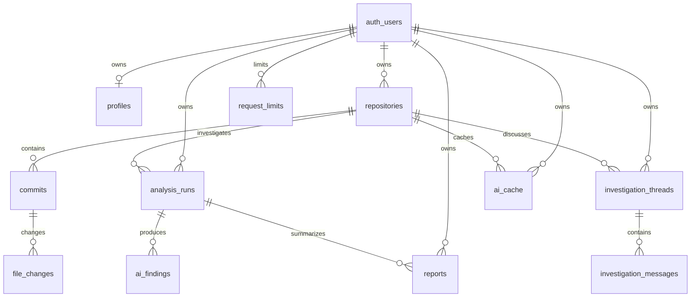

# Database setup

Target project: `beezpkgdrxpidyhzcvuq`. App configuration is in the ignored `.env.local`; do not commit it.

## Migration

Apply `supabase/migrations/20261028155647_initial_schema.sql` once, after inspecting the target schema. The migration does not drop existing tables. If any of its table names already exist, inspect and reconcile them before applying it; do not delete existing data to force setup.

On October 29, 2026, the dashboard SQL Editor confirmed zero application tables/functions, then the initial migration was applied successfully inside an explicit transaction. The Data API schema cache was reloaded. The connected plugin still denies access, so dashboard access was used. **Do not rerun the initial CREATE script on this project.** SQL Editor execution does not populate CLI migration history; reconcile that history before a future CLI database push.

## Tables and relationships

All tables are in `public` except `private.request_limits`. Ownership is verified through `auth.uid()` and parent foreign keys. Deleting an owned repository cascades through its commits, file changes, analyses, findings, conversations, reports and cached analyses. Deleting a profile does not delete its auth account.

Unique keys prevent duplicate repositories per owner, duplicate SHAs per repository, duplicate changed file paths per commit, and duplicate AI cache entries per owner. Status, severity, evidence status and message roles are constrained. All exposed tables have row-level security enabled with ownership checks on both existing and new rows.

## Verification after application

1. Inspect table definitions, foreign keys, indexes and RLS policies through the Supabase plugin.
2. Run security and performance advisors.
3. Confirm unauthenticated clients cannot read protected application data.
4. Use two dedicated confirmed accounts to run `tests/supabase.integration.test.ts`, including child inserts and ownership transfer attempts.
5. Sign in through the app and verify repository persistence. The empty workspace should show onboarding rather than a missing-schema error.

Email authentication is enabled. Site URL points to the Render app, and its exact confirmation and recovery callbacks are now saved in the redirect allowlist.

## Repository import failure diagnosis

On October 29, 2026 the public GitHub metadata request for octocat/Hello-World returned HTTP 200. The Supabase Data API returned PGRST205 for repositories and PGRST202 for consume_request using the public client identity. The authenticated import route invokes consume_request before GitHub, so missing migration objects can block imports before repository retrieval. Anonymous probes alone do not establish the complete schema or authenticated grants; inspect the project before applying SQL.

After dashboard sign-in, SQL inspection confirmed the application schema was absent. The migration now exists: 11 tables (10 public plus private counters), all with RLS, 10 ownership policies, and 15 foreign keys. Authenticated repository CRUD and quota execution privileges are present. Anonymous REST access now returns permission denied rather than missing-object errors. Missing table/function errors have a specific sanitized setup message; raw database failures remain private.

The hosted transaction in `supabase/tests/authorization-smoke.sql` passed owner CRUD and quota checks, then confirmed cross-user reads, updates, deletes and forged ownership are blocked. It used two existing Auth identities and rolled back every verification write. It did not issue tokens or alter Auth users. A live app-session import remains to be verified after the user signs in.

Dashboard advisors were reviewed after migration: unused indexes are expected in a newly created schema; the private counter intentionally has RLS without client policies; the authenticated SECURITY DEFINER RPC is a deliberately narrow quota endpoint with an empty search path, UID checks and fixed upper limits. The Auth leaked-password-protection warning remains an account configuration item; it was not represented as resolved.
