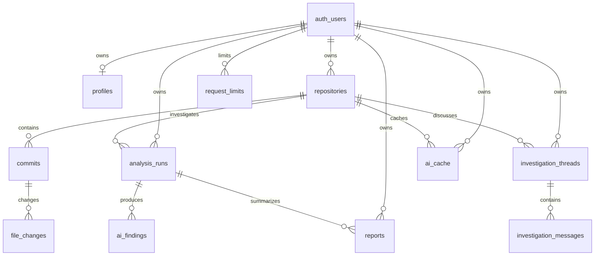

# Database setup

Target project: `beezpkgdrxpidyhzcvuq`. App configuration is in the ignored `.env.local`; do not commit it.

## Migration

Apply `supabase/migrations/20261028155647_initial_schema.sql` once, after inspecting the target schema. The migration does not drop existing tables. If any of its table names already exist, inspect and reconcile them before applying it; do not delete existing data to force setup.

The Supabase plugin currently has no accessible projects and denied inspection of this project. Reconnect it with an account that has project access, then ask to continue the database migration. Alternatively, an authorized project administrator can run the migration in the project's [SQL Editor](https://supabase.com/dashboard/project/beezpkgdrxpidyhzcvuq/sql/new).

## Tables and relationships

All tables are in `public` except `private.request_limits`. Ownership is verified through `auth.uid()` and parent foreign keys. Deleting an owned repository cascades through its commits, file changes, analyses, findings, conversations, reports and cached analyses. Deleting a profile does not delete its auth account.

Unique keys prevent duplicate repositories per owner, duplicate SHAs per repository, duplicate changed file paths per commit, and duplicate AI cache entries per owner. Status, severity, evidence status and message roles are constrained. All exposed tables have row-level security enabled with ownership checks on both existing and new rows.

## Verification after application

1. Inspect table definitions, foreign keys, indexes and RLS policies through the Supabase plugin.
2. Run security and performance advisors.
3. Confirm unauthenticated clients cannot read protected application data.
4. Use two dedicated confirmed accounts to run `tests/supabase.integration.test.ts`, including child inserts and ownership transfer attempts.
5. Sign in through the app and verify repository persistence. The empty workspace should show onboarding rather than a missing-schema error.

Email authentication is already enabled according to the public Auth settings endpoint. Configure Site URL and redirect allowlists for `https://phantomcommitai.onrender.com/auth/callback` and the recovery callback as documented in README before testing verification email and password reset.
